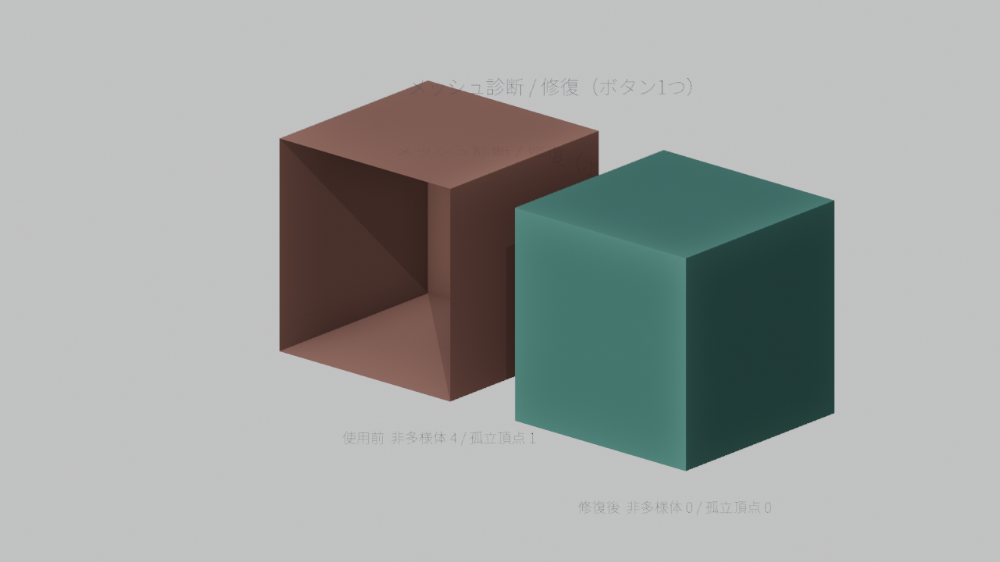
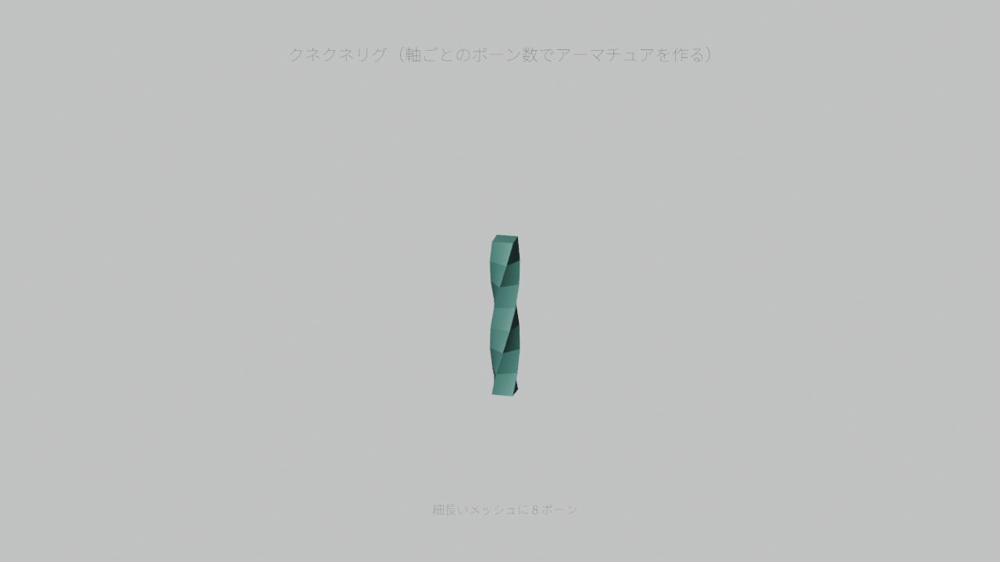
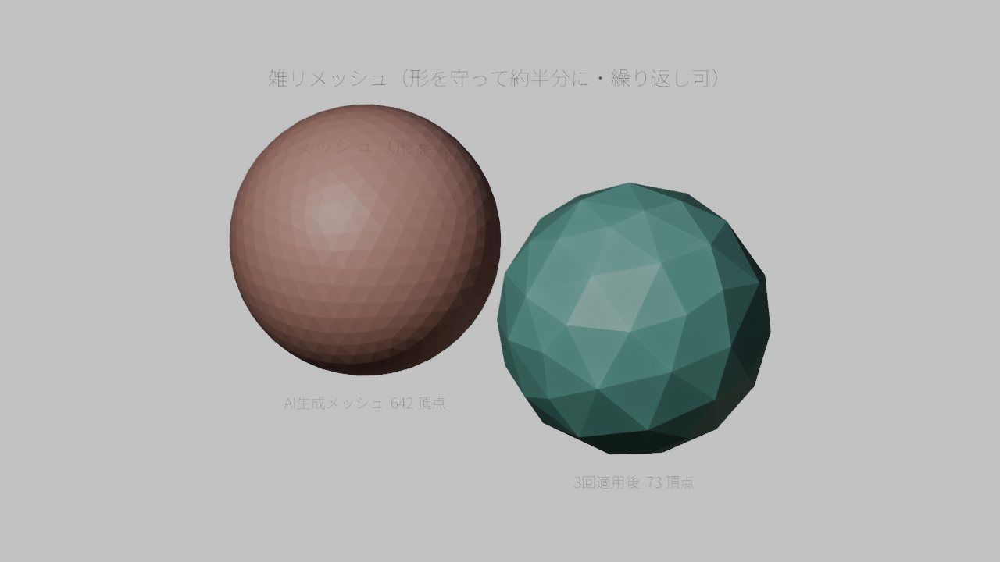
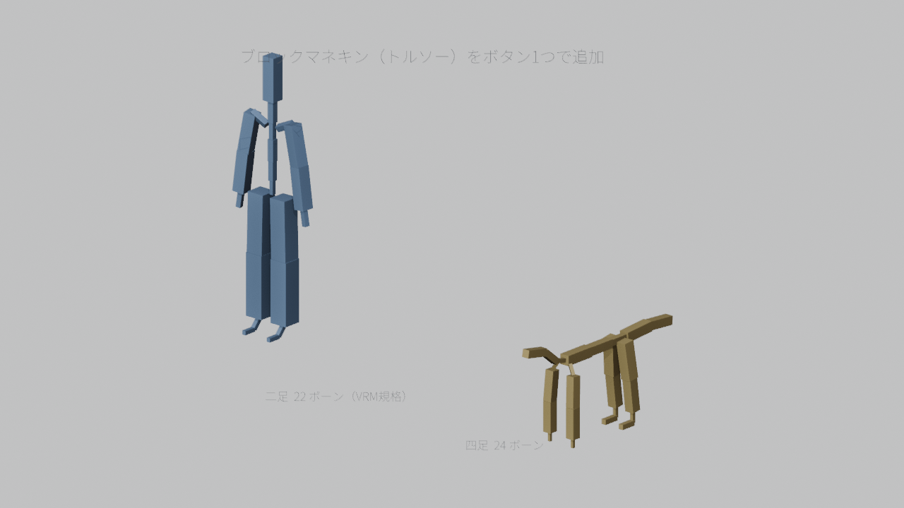
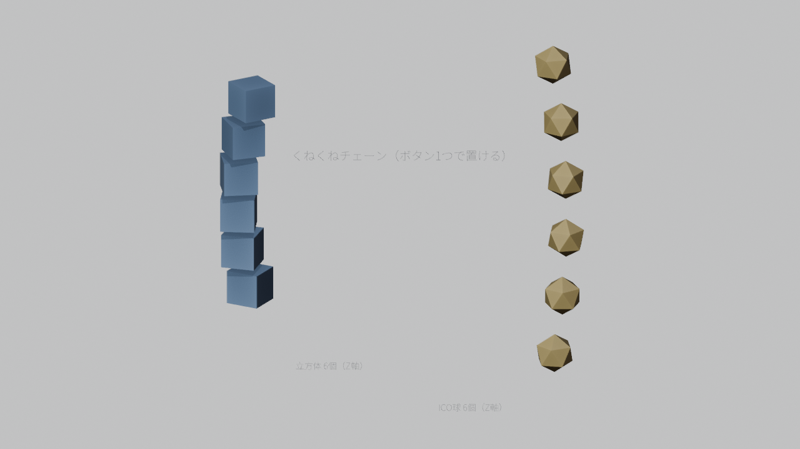
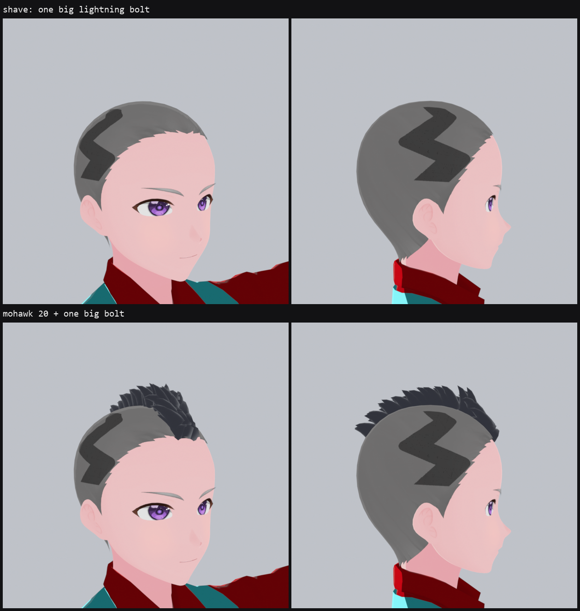

# うのっち Blender アドオン

VTuber・3D制作・デジタル教育の現場で使うために作った Blender アドオン集です。
Blender 4.2 以降（開発・検証は 5.2 LTS）で動きます。

<!-- EN:START -->
## English

Free, MIT-licensed Blender add-ons for 3D work and digital education. Blender 4.2+ (developed and tested on 5.2 LTS).

| Add-on | What it does | Where |
|---|---|---|
| **Unotchi Mesh Doctor** | Scan and repair AI-generated meshes in one click | 3D Viewport > Sidebar (N) > うのっち tab > Mesh Doctor |
| **Unotchi Auto Snake Rig** | Generate a wiggly rig from X/Y/Z bone counts | 3D Viewport > Sidebar (N) > うのっち tab > Snake Rig |
| **Unotchi Zatsu Remesh** | Safe half-decimation for heavy AI meshes | 3D Viewport > Sidebar (N) > うのっち tab > Zatsu Remesh |
| **Unotchi Torso Rig** | Block mannequin, humanoid (ver2) and a 168-tri chibi | 3D Viewport > Sidebar (N) > うのっち tab > Torso |
| **Unotchi Wiggle Place** | Place wiggly meshes in one click (array + armature) | 3D Viewport > Sidebar (N) > うのっち tab > Wiggle Place |
| **Unotchi Forge** | VRM-ready procedural mohawk, horns and shaved patterns | 3D Viewport > Sidebar (N) > うのっち tab > Hair Forge / Horn Forge / Shave Forge |
| **Unotchi Face Bars** | Black-plate eyes and mouth with aa/ih/ou/ee/oh + blink, bound to VRM expressions | 3D Viewport > Sidebar (N) > うのっち tab > Face Bars |
| **Unotchi VRM Bone Replace** | Remap a Tripo/Mixamo/UE rig to VRM 1.0 humanoid names and hierarchy | 3D Viewport > Sidebar (N) > うのっち tab > VRM Bones |
| **Unotchi Auto Humanoid Rig** | Rig an unrigged humanoid mesh with VRM 1.0 bones and weights | 3D Viewport > Sidebar (N) > うのっち tab > Auto Rig |
| **Unotchi VRM Meta** | Set VRM title, author, license and thumbnail from inside Blender | 3D Viewport > Sidebar (N) > うのっち tab > VRM Meta |

**Install** — in Blender, open `Get Extensions` and add this repository URL (one-tap install, and updates arrive automatically):

    https://unotchi.com/unotchi-blender-addons/repository/index.json

Or download a `.zip` from [Releases](../../releases) and use `Install from Disk`. Step-by-step guide: [docs/install-en.md](docs/install-en.md).

<!-- EN:END -->

## 収録アドオン

<!-- ADDONS:START -->
| アドオン | 何をする | パネル | 状態 |
|---|---|---|---|
| **メッシュ診断・一括修復** | 生成AIメッシュの非多様体・孤立頂点・ゼロ面積面・重複頂点・法線反転・スケール未適用を数え、1ボタンで直す。 | 3Dビューポート > N パネル > うのっち > Mesh Doctor | 合格 |
| **クネクネリグ自動生成** | 選んだメッシュに X/Y/Z 方向のボーン数を指定してアーマチュアを自動生成。頂点数に応じた上限つき。 | 3Dビューポート > N パネル > うのっち > クネクネリグ | 合格 |
| **雑リメッシュ（半減）** | 生成AIの高ポリメッシュを、形を崩しにくい順序で約半分に減らす。押すたびに段階的に半減する。 | 3Dビューポート > N パネル > うのっち > 雑リメッシュ | 合格 |
| **トルソー（ブロックマネキン / ver2 人体 / ディフォルメ△256）** | VRM1.x の humanoid ボーンで二足22本／四足24本のアーマチュアを作る。ver2 では頭・胴・手足の箱を組み合わせた「そのまま使える人体」を剛体ウェイト付きで生成する。ディフォルメは箱14個＝168tri・23ボーン（目と口は黒板顔アドオンで後付け）で、VRM 1.0 として書き出せ、3tene V PRO で読み込み・まばたき／口パクまで動作確認済み。 | 3Dビューポート > N パネル > うのっち > トルソー | 合格 |
| **くねくねチェーン** | 個数・サイズ・間隔・軸を決めてボタン1つ。立方体／ICO球／選択メッシュを並べ、ボーン1本ずつでくねくね動くアーマチュアを作る。 | 3Dビューポート > N パネル > うのっち > くねくねチェーン | 合格 |
| **うのっち Forge（モヒカン・ツノ・剃り込み）** | VRoid/VRM の頭部に沿って、モヒカン（束）・ツノ・剃り込みを手続き生成する。生成物は頭ボーンにウェイト済みでVRMにそのまま書き出せ、剃り込みは頭皮テクスチャへ直接焼く。 | 3Dビューポート > N パネル > うのっち > Hair Forge / Horn Forge / Shave Forge | 合格 |
| **黒板顔（目・口）** | リグ済みキャラの顔に黒い板ポリの目と口を面に沿って作り、VRM1.0の表情プリセット（blink/aa/ih/ou/ee/oh）に結線する。3tene等でまばたき・口パクが動く。 | 3Dビューポート > N パネル > うのっち > 黒板顔（目・口） | 合格 |
| **VRMボーン置換** | 取り込んだリグのボーン名・親子関係・頂点グループ名を VRM 1.0 humanoid に置き換える。名前で当たらないぶんは骨格の形から推定し、眼球ボーンも必要なら作る。診断ボタンで実行前に確認できる。 | 3Dビューポート > N パネル > うのっち > VRMボーン置換 | 合格 |
| **自動リグ（VRM1.0）** | リグの無い人体メッシュの断面を実測して VRM1.0 humanoid（22本＋眼球2本）とウェイトを作る。分割モデルは1パーツ=1ボーン、1枚シェルは自動ウェイト→距離方式へ自動で切り替える。 | 3Dビューポート > N パネル > うのっち > 自動リグ（VRM1.0） | 合格 |
| **VRMメタ（名前・サムネ）** | VRMの名前・バージョン・作者・連絡先・ライセンス・サムネイルを日本語パネルから設定する。サムネイルはビューポートの見た目をそのまま撮影（3Dビューが無いときはカメラレンダー）して埋め込む。 | 3Dビューポート > N パネル > うのっち > VRMメタ（名前・サムネ） | 合格 |
<!-- ADDONS:END -->

<!-- USAGE:START -->
## 使用イメージ

すべて Blender 5.2 のヘッドレス実行で、**実際にそのアドオンを動かして描いた画像**です（検証と同じ経路。撮り直しは工場側の `tools/render_usage_images.py`）。

### メッシュ診断・一括修復



生成AIメッシュの非多様体・孤立頂点・ゼロ面積面・重複頂点・法線反転・スケール未適用を数え、1ボタンで直す。

### クネクネリグ自動生成



選んだメッシュに X/Y/Z 方向のボーン数を指定してアーマチュアを自動生成。頂点数に応じた上限つき。

### 雑リメッシュ（半減）



生成AIの高ポリメッシュを、形を崩しにくい順序で約半分に減らす。押すたびに段階的に半減する。

### トルソー（ブロックマネキン / ver2 人体 / ディフォルメ△256）



VRM1.x の humanoid ボーンで二足22本／四足24本のアーマチュアを作る。ver2 では頭・胴・手足の箱を組み合わせた「そのまま使える人体」を剛体ウェイト付きで生成する。ディフォルメは箱14個＝168tri・23ボーン（目と口は黒板顔アドオンで後付け）で、VRM 1.0 として書き出せ、3tene V PRO で読み込み・まばたき／口パクまで動作確認済み。

### くねくねチェーン



個数・サイズ・間隔・軸を決めてボタン1つ。立方体／ICO球／選択メッシュを並べ、ボーン1本ずつでくねくね動くアーマチュアを作る。

### うのっち Forge（モヒカン・ツノ・剃り込み）



VRoid/VRM の頭部に沿って、モヒカン（束）・ツノ・剃り込みを手続き生成する。生成物は頭ボーンにウェイト済みでVRMにそのまま書き出せ、剃り込みは頭皮テクスチャへ直接焼く。

<!-- USAGE:END -->
## いちばん楽な方法: リポジトリを追加する（おすすめ）

Blender にこのリポジトリを登録すると、一覧から入れて**更新も自動で受けられます**。

1. `編集 > プリファレンス > エクステンションを入手` を開く
2. 右上の `リポジトリ` のドロップダウン → `+` → **リモートリポジトリを追加**
3. URL にこれを貼る:

   ```text
   https://unotchi.com/unotchi-blender-addons/repository/index.json
   ```

4. 名前は好きに（例: `unotchi add-ons`）。OK すると一覧に「Unotchi ...」が並ぶ
5. 使いたいアドオンの **インストール** を押す

> `https://github.com/...` のような**GitHub のリポジトリ URL では動きません**。
> Blender が読むのは上記の `index.json` です。うまくいかないときは、その誤った
> リポジトリを `-` ボタンで消してから入れ直してください。

### 手動で入れる場合（zip）

[Releases](../../releases) から `.zip` をダウンロードして、
Blender で `編集 > プリファレンス > Get Extensions > Install from Disk` を選んで読み込ませます。
くわしくは [docs/install.md](docs/install.md)（日本語）/ [docs/install-en.md](docs/install-en.md)（English）。

## 動作環境

- Blender 4.2 以降（拡張機能パッケージ形式。検証は 5.2 LTS）
- OS は Windows で検証しています
- 外部ライブラリ・外部サービスへの依存はありません

## ライセンス

MIT（[LICENSE](LICENSE)）。自由に使えます。改造・再配布も歓迎します。

## 生成支援について

初稿のコード生成に AI（Backboard.io の Backboard Studio）を使い、そのあと人手でレビュー・
修正・検証を行って公開しています。検証は [addons/*](addons) ごとに用意したテストで実施しています。

## 開発（ビルド方法）

```powershell
# 各アドオンを拡張機能パッケージ（zip）にビルド → releases/ へ
python tools/build_all.py
```

個別にビルドする場合:

```powershell
cd addons/unotchi_mesh_doctor
blender --command extension build
```

## こまったとき

- 不具合・要望は Issues へ。Blender のバージョンと、`ウィンドウ > システムコンソール` の赤い文字を添えてください。
